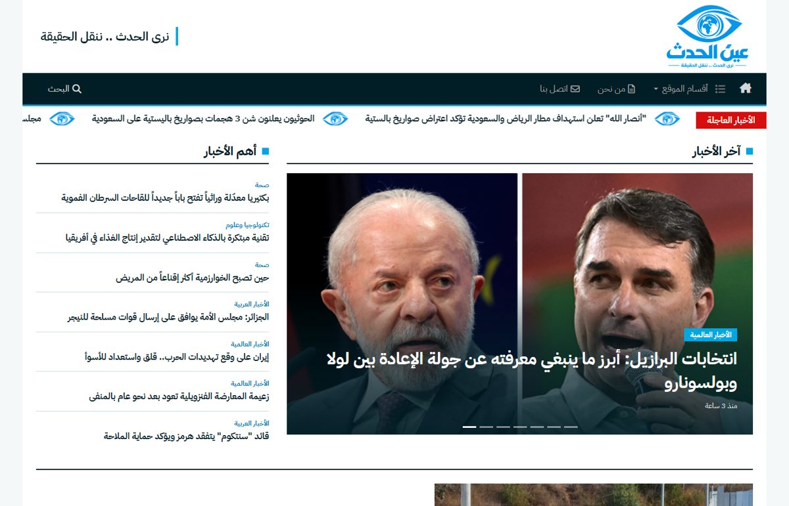
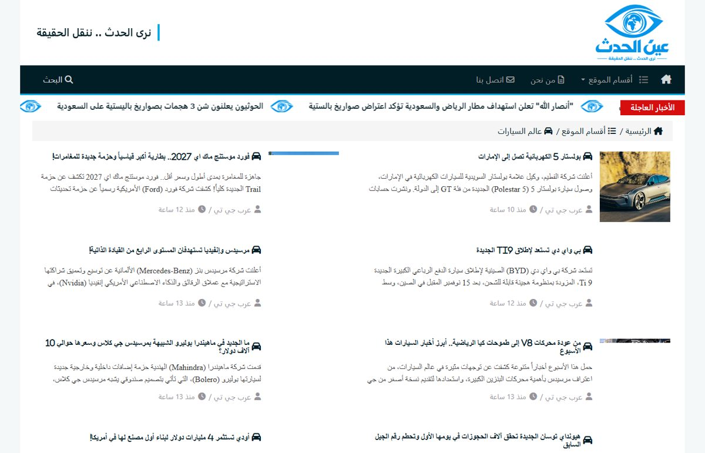
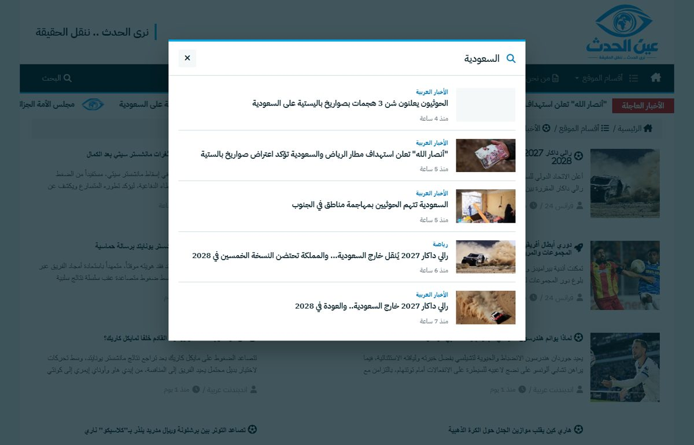
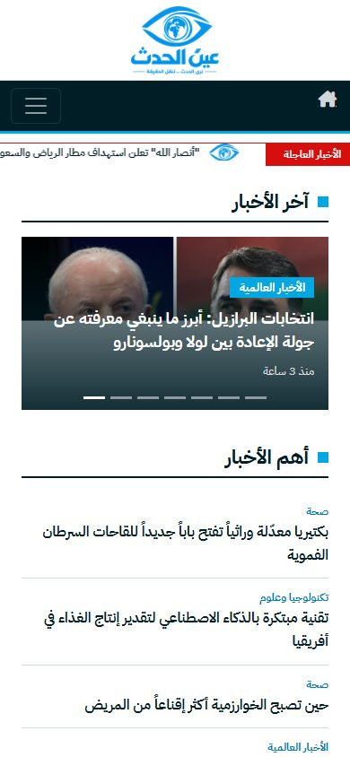

# عين الحدث | Ain Al-Hadath

**نرى الحدث .. ننقل الحقيقة**

An Arabic (RTL) news website with a public site, an admin dashboard, and a PHP/MySQL API. The front end is built with Angular 16, and the news content is imported from public RSS feeds with full source attribution.

**Live demo:** https://hudamohamad.github.io/news_eye/

The live demo is a static build of the public site. GitHub Pages can't run PHP, so it reads the news from pre-exported JSON files instead of the API (see [Live demo build](#live-demo-build)).



## Features

**Public site** (`sst/projects/user`)
- Home page in the style of international news sites: a hero slider, top stories, a featured story, photo news, editor's picks, most read and video
- 12 news sections (Arab news, world news, business, sport, culture, investigations, opinion, tech and science, society, cars, health, space), each with its own paginated page
- Live search across all sections, with debounced requests, thumbnails, section labels and relative times
- A breaking-news ticker
- A responsive layout for desktop, tablet and mobile
- An image fallback directive, so broken image links show a branded placeholder

**Admin dashboard** (`sst/projects/admin`)
- Session-based login with bcrypt passwords and brute-force protection (5 attempts / 15 minutes per IP)
- Create, edit and delete posts with a rich-text editor
- Manage breaking news, videos, sections and social links
- A visits and analytics dashboard

**Backend** (`backend`)
- A PHP REST API over MySQL, configured through `.env`
- `import_news.php`, which imports real headlines from public Arabic RSS feeds, sorts them into sections, and fills the home page

## Screenshots

| Section page | Search | Mobile |
|---|---|---|
|  |  |  |

## Tech stack

| Layer | Technology |
|---|---|
| Front end | Angular 16, TypeScript, RxJS, Bootstrap 5, Font Awesome |
| Back end | PHP 8 (mysqli and PDO) |
| Database | MySQL / MariaDB |
| Fonts | IBM Plex Sans Arabic |

## Project structure

```
news/
├── backend/              PHP API (one endpoint per file)
│   ├── config.php        loads .env
│   ├── import_news.php   RSS news importer
│   └── upload/           uploaded images (not tracked)
├── database/
│   └── schema.sql        tables + demo data
├── sst/                  Angular workspace
│   └── projects/
│       ├── user/         public website
│       └── admin/        admin dashboard
└── docs/screenshots/
```

## Getting started

### Requirements
- [XAMPP](https://www.apachefriends.org/), or any setup with Apache, PHP 8 and MySQL/MariaDB
- Node.js 18 or later

### 1. Backend and database
1. Clone the repo into `C:\xampp\htdocs\news`. The front end calls the API at `http://localhost/news/backend`.
2. Start **Apache** and **MySQL** from the XAMPP Control Panel.
3. Create a database named `sstnews_webdb` (collation `utf8mb4_general_ci`) and import [`database/schema.sql`](database/schema.sql):
   ```bash
   mysql -u root -e "CREATE DATABASE sstnews_webdb CHARACTER SET utf8mb4 COLLATE utf8mb4_general_ci"
   mysql -u root --default-character-set=utf8mb4 sstnews_webdb < database/schema.sql
   ```
4. Copy the environment file and fill in your values:
   ```bash
   cp backend/.env.example backend/.env
   ```

### 2. Front end
```bash
cd sst
npm install
npx ng serve user                 # public site:  http://localhost:4200
npx ng serve admin --port 4201    # admin panel:  http://localhost:4201
```

**Demo admin login:** `admin@example.com` / `Admin@12345`. Change it after the first login.

## Importing news

```bash
cd backend
php import_news.php            # fetch the latest headlines from the RSS feeds
php import_news.php --reflag   # only redistribute the home page, without fetching
```

- Each section keeps at most 20 imported stories (two pages).
- Duplicates are skipped by link and by title.

## Live demo build

The GitHub Pages version runs without any server:

- `npm run build:pages` builds the public site with the `pages` configuration (`baseHref` `/news_eye/`). It also writes a `404.html` copy of the app, so deep links such as `/news_eye/part-5` work.
- In that build, [`static-api.ts`](sst/projects/user/src/static-api.ts) redirects every request to the PHP API to a JSON file in `assets/api/`. Search runs in the browser over `search-index.json`.
- To refresh the JSON files, run the following with the backend running locally:

```bash
cd sst
npm run export:static-api   # saves the API responses to projects/user/src/assets/api
npm run build:pages         # output: dist/pages, deployed to the gh-pages branch
```

## Content and attribution

The news content is imported from public RSS feeds published by اندبندنت عربية, سكاي نيوز عربية, فرانس 24, بي بي سي عربي, الشرق الأوسط and عرب جي تي.

Only the headline, a short summary and the image link are stored. Every story names its source and links to the original article. All rights to the news content and images belong to their publishers. This project is a portfolio and demo project and is not a commercial news service.
